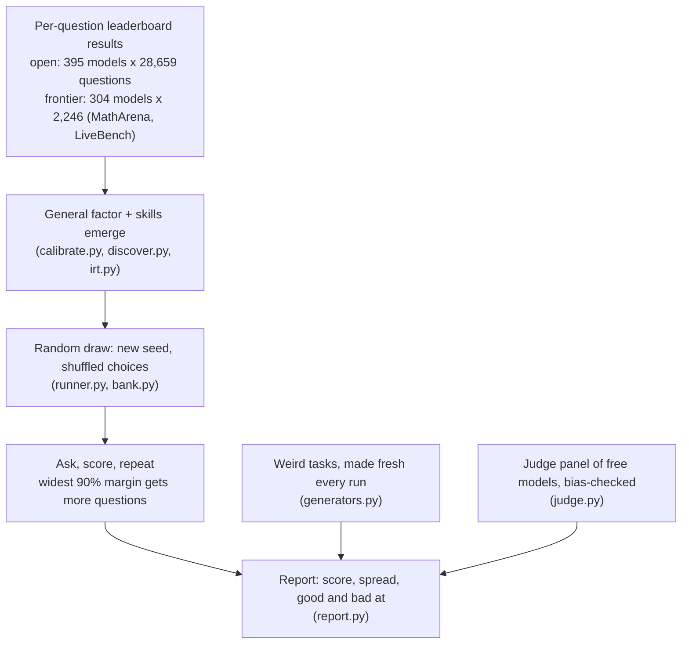

# gfactor-bench

A psychometric test for AI models. It reports a general factor score (g), skill factors that the data finds on its own, a spread score, and a 90% interval on each.

Scores are open-ended, like a game rating: 1000 is the average of the reference models and 200 points is one standard deviation. There is no ceiling or floor.

Two question banks, each with its own reference models:

| Bank | Questions | Reference models | Use it for |
|---|---|---|---|
| `open` (default) | 28,659 Open LLM Leaderboard v1 questions: MMLU, ARC, HellaSwag, Winogrande, TruthfulQA, GSM8K | 395 open models from 2023 to 2024 | small and mid-size models |
| `frontier` | 2,246 questions: MathArena olympiad math (AIME, HMMT, SMT, BRUMO, CMIMC, Kangaroo, Apex, IMO, USAMO, Putnam, IMC, arXiv research problems) and LiveBench (coding, instruction following, language puzzles) | 304 models, frontier and open, 2024 to 2026 | strong models that max out the open bank |

Scores from the two banks sit on different scales. The banks share no models, so no link between them can be estimated.

```
g = 1474 (90% interval 1408 to 1540), spread = 112
  <factor named after its top subjects>   1602  (+128 vs g, 90% +31 to +225)
  ...
report: reports/<model>_<seed>.html
```

## Pipeline



## Quick start

```bash
git clone https://github.com/Questboy23/gfactor-bench && cd gfactor-bench
uv sync
uv run gfb test ollama/qwen3.5:9b                            # any local Ollama model, open bank
GROQ_API_KEY=... uv run gfb test groq/openai/gpt-oss-120b --bank frontier
```

Any [LiteLLM](https://docs.litellm.ai/docs/providers) model name works: `ollama/`, `groq/`, `gemini/`, `openrouter/`, `openai/`, `anthropic/`, `nvidia_nim/` and 100+ others. Keys come from the provider's usual environment variable.

The open-ended section uses a judge panel of free API models (Groq, Gemini, OpenRouter free). Set `GROQ_API_KEY`, `GEMINI_API_KEY` and `OPENROUTER_API_KEY` (all have free tiers), and run `ollama pull nomic-embed-text` for the novelty embeddings. Reference answers for all 30 prompts ship in the repo; the fixed opponent is `groq/openai/gpt-oss-20b`, which is not on the judge panel. Skip it with `--open 0`, or choose judges with `--judges ...`.

## What it measures

| Part | Source | How it is scored |
|---|---|---|
| g and data-driven skill factors | `open` or `frontier` bank (table above) | Bifactor item response model calibrated on that bank's reference models |
| Spread | the skill factors | SD of skill deviations from g, minus the part measurement noise explains |
| Odd tasks | 8 generators: letter counting, ciphers, big arithmetic, sorting, word reversal, weekday math, grid positions, an invented language | Exact match, fresh items every run |
| Open-ended | 30 prompts: poetry, advice, ideas, explanations | Pairwise judge panel versus reference answers, plus a novelty bonus |

g and factor scores: 1000 = reference average, 200 points = 1 SD, unbounded. Factor scores also show how far each sits above or below what g predicts.

## How it works

**Skill factors are found, not named by hand** (`discover.py`):
1. Accuracy per benchmark or MMLU subject for each reference model, computed on two random halves of the questions.
2. g (the first principal component) is removed from both halves.
3. Residuals are correlated across halves. Sampling noise in one half does not correlate with the other half, so only real shared skill remains.
4. Parallel analysis sets the number of factors: eigenvalues above the 95th percentile of a null that shuffles each subject's scores among the models tested on it.
5. Removing g costs one dimension, so k significant eigenvalues mean k + 1 skill groups. Subjects are placed by their direction in those eigenvectors and clustered into k + 1 groups; groups under 3 subjects join their nearest group. Each factor is named after its 3 most central subjects.
6. In the item model, each factor's model scores start and stay at the observed leftover skill, so a factor cannot drift into noise.

Missing data is handled throughout. A model not tested on a question is left out of that question's likelihood, and two subjects' correlation counts only when at least 20 models took both. In the frontier bank only 12 models appear on both MathArena and LiveBench, so factors are found within each leaderboard: 6 in MathArena, 1 in LiveBench. Scores in [0, 1] work as soft labels: MathArena averages several attempts per problem and scores proofs as judge points over maximum points.

On the 395 open-bank reference models this finds 6 factors. g matches overall accuracy at r = 0.988, and each factor score matches its own leftover accuracy at r = 0.82 to 1.00.

A simulated test with 3 planted skill groups recovers all 3 exactly.


1. **Calibration.** `tinyBenchmarks` (Polo et al. 2024, MIT) published right/wrong results of 395 models on every leaderboard question. MathArena and LiveBench publish every model's score on every question. `gfb calibrate` (open) and `gfb calibrate frontier` fit a bifactor 3PL model to each matrix: each question loads on g and on one skill factor, with a fixed guessing floor. DuckDB reads only the score columns of the MathArena and LiveBench parquet files by HTTP range requests, so the full model transcripts (several GB) are never downloaded. The fitted parameters ship in `src/gfactor_bench/data/`, so users never download any matrix.
2. **Random draw.** Each run uses a new seed (saved in the report). It takes a random 40% slice of the bank, starts with 4 random questions per factor, and shuffles answer choices so memorized letters do not help.
3. **Adaptive testing.** After each batch the model's abilities are re-estimated (MAP with a Laplace posterior). The factor with the widest 90% interval relative to its target gets the next batch: the questions that shrink that interval most, picked at random among the top 8 (randomesque exposure control). It stops when g is within ±80 points and each factor within ±130 (defaults), or at 300 questions.
4. **Questions are fetched one row at a time** from the Hugging Face datasets-server API and cached in `~/.cache/gfactor-bench`. Nothing is bulk-downloaded.
5. **Judge panel.** Five free models from four families (OpenAI gpt-oss, Qwen, Gemini, NVIDIA Nemotron) compare the tested answer with a fixed reference answer in both orders, which cancels position bias. Judges see a blind prompt that tells them to grade reasoning and craft, not agreement with popular opinion. Brand self-mentions are stripped. The report gives win rate, a 90% bootstrap interval over prompts and judges, and the SD between judges.
6. **Novelty.** Distance of the answer's embedding from a pool of standard answers to the same prompt. It adds to the score only when the answer also beats the reference, so odd but bad answers earn nothing.
7. **Judge audit** (`gfb audit-judges`). Each judge sees planted pairs where one side is a damaged copy (a dropped passage, shuffled sentences, a wrong number), so the right pick is known. This gives each judge's error rate and the correlation of errors between judges. Consensus pairs keep the same evidence and flip only the conclusion between consensus and contrarian. The score shift is that judge's consensus bias. Judge weights drop with error rate and bias.

### First judge audit (shipped in `data/judge_audit.json`)

| Judge | Planted-error rate | Consensus bias | Weight |
|---|---|---|---|
| groq gpt-oss-120b | 0% | -0.50 (picked the consensus version every time) | 0 |
| groq qwen3.8-27b | 0% | 0.00 | 1.00 |
| gemini-3.5-flash-lite | 4% | +0.33 (leans contrarian) | 0.31 |
| openrouter nemotron, ernie | not measured (free quota used up) | | 1 until audited |

Error correlation between judges is undefined so far: with 0 to 1 errors per judge there is no variance. More planted pairs (`-n 50`) are needed to measure it.

## Report

`reports/<model>_<seed>.html` (also `.md` and `.json`) contains g and spread with 90% intervals, each skill factor's score and deviation from g, odd-task and open-ended results, a judge table, the 5 best and 5 worst areas versus what g predicts, a factor chart, and a skill correlation heatmap across the reference models.

## Limits


- The open bank's reference models are 2023 to 2024 open models. Strong modern models sit near its top; use `--bank frontier` for them.
- Frontier bank: 85% of the model-by-question matrix is missing, and only 12 models link MathArena with LiveBench, so the relative placement of the two leaderboards rests on those 12. Some MathArena factors partly track which models were evaluated when (2025 versus 2026 competitions).
- Frontier bank: 1,432 of 2,246 questions can be asked at test time. Proofs, Lean, broken-problem sets, Kangaroo (no text answer), LiveBench coding, instruction following and plot unscrambling only shape the calibration. A factor with no askable questions shows 0 questions and a wide interval.
- Frontier bank math answers are compared after light LaTeX normalization (`\dfrac` to `\frac`, spaces, `\left`/`\right`). Equivalent forms written differently, like `0.5` and `\frac{1}{2}`, count as wrong.
- Open LLM Leaderboard v2 per-question files exist, but each model's file needs a logged-in Hugging Face account that accepted its terms, so v2 is not used.
- Calibration used log-likelihood scoring with few-shot prompts. This tool asks zero-shot and reads a letter or number, so item parameters transfer only approximately.
- Odd tasks and open-ended scores are reported apart from g. They need 30+ tested models before they can be calibrated into the factor model.
- Free API tiers have rate limits. The runner retries with backoff, counts API errors in the report, and leaves them out of the scores.
- Reasoning models that use their whole token budget on thinking return empty text. That counts as an API error, not a wrong answer. Judges and reference answers request low reasoning effort.

## Credits

- Response matrix: [tinyBenchmarks](https://github.com/felipemaiapolo/tinyBenchmarks) (MIT).
- Idea of stitching benchmarks into one capability scale: [Epoch Capabilities Index](https://github.com/epoch-research/eci-public) (MIT). This repo works with single questions rather than whole benchmarks, and adds skill factors, adaptive testing and judges.
- Questions come at runtime from MMLU, ARC, HellaSwag, Winogrande, TruthfulQA and GSM8K on Hugging Face, under their own licenses.
- Frontier bank: [MathArena](https://matharena.ai) per-question results and problems (CC BY-NC-SA 4.0) and [LiveBench](https://livebench.ai) judgments and questions (Apache 2.0). `data/frontier_items.json` ships the askable problems with attribution under those licenses.
- Model access: [LiteLLM](https://github.com/BerriAI/litellm).

## Development

```bash
uv run pytest            # offline tests: model recovery, 90% interval coverage, parsers, generators
uv run gfb calibrate             # refit the open bank (about 20 minutes on a laptop)
uv run gfb calibrate frontier    # refit the frontier bank (about 5 minutes the first time, 15 seconds once cached)
```
